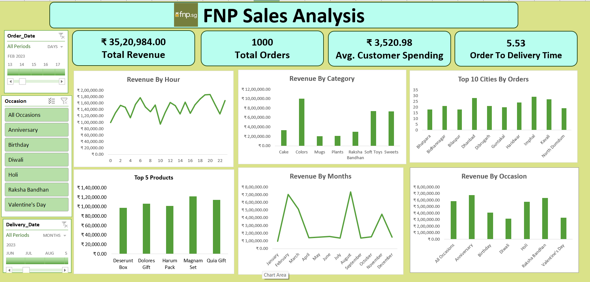

# Excel-project-FNP-sales-analysis


# FNP Sales Analysis Dashboard

An interactive sales analysis dashboard built using Microsoft Excel to analyse revenue performance, order trends, product categories, customer purchasing patterns, and delivery efficiency.

## Dashboard Preview



## 1. Project Overview

The FNP (Ferns N Petals) Sales Analysis project focuses on analysing business sales performance using three datasets: Orders, Customers, and Products.

The datasets were cleaned, transformed, and integrated into a structured data model using Power Query and Power Pivot. DAX was used for revenue calculations, while Pivot Tables, Pivot Charts, Slicers, and Timelines were used to develop an interactive dashboard.

The primary objective was to transform raw transactional data into meaningful business insights that support better decision-making.

## 2. Business Objectives

- Analyse overall sales performance using key performance indicators (KPIs).
- Identify high-revenue product categories and occasions.
- Understand monthly and hourly revenue trends.
- Identify top-performing products.
- Analyse order distribution across different cities.
- Evaluate average order value and delivery performance.
- Develop an interactive dashboard for dynamic data exploration.

## 3. Tools and Technologies

| Tool | Purpose |
|---|---|
| Microsoft Excel | Data analysis and dashboard development |
| Power Query | Data cleaning and transformation |
| Power Pivot | Data modelling and integration |
| DAX | Revenue calculation |
| Pivot Tables | Data summarisation and analysis |
| Pivot Charts | Data visualisation |
| Slicers & Timelines | Interactive dashboard filtering |

## 4. Data Preparation and Modelling

The project uses three datasets:

- **Orders:** Transactional and sales information.
- **Customers:** Customer-related information.
- **Products:** Product-related information.

### Power Query – Data Cleaning

Power Query was used to:
- Clean and transform the raw datasets.
- Handle data inconsistencies.
- Create additional columns required for analysis.
- Prepare datasets for data modelling.

### Power Pivot – Data Modelling

Power Pivot was used to integrate the Orders, Customers, and Products datasets into a unified data model by establishing relationships between the tables.

### DAX – Revenue Calculation

DAX (Data Analysis Expressions) was used within Power Pivot to calculate revenue and support sales performance analysis across different business dimensions.

## 5. Key Performance Indicators (KPIs)

| KPI | Result |
|---|---:|
| Total Revenue | ₹35,20,984 |
| Total Orders | 1,000 |
| Average Order Value | ₹3,520.98 |
| Average Order-to-Delivery Time | 5.53 |

## 6. Key Business Insights

### Revenue by Category
Colors is the highest revenue-generating category, contributing approximately ₹10 lakh, followed by Soft Toys and Sweets.

### Revenue by Occasion
Anniversary generates the highest revenue among individual occasions, followed by Raksha Bandhan.

### Monthly Revenue Trends
February and August are among the strongest revenue-generating months, highlighting variations in seasonal sales performance.

### Revenue by Hour
Hourly revenue analysis reveals variations in purchasing activity throughout the day.

### Top 5 Products
Magnum Set is the highest revenue-generating product among the five products displayed, followed by Quia Gift and Dolores Gift.

### Geographical Sales Analysis
Imphal, Dhanbad, and Kanpur are among the leading cities by order volume in the displayed analysis.

### Delivery Performance
The dashboard reports an average order-to-delivery time of 5.53, providing an overview of delivery performance.

## 7. Business Recommendations

Based on the analysis, the following recommendations could support better business decisions:

1. **Category Performance:** Focus on inventory planning and promotional campaigns for high-revenue categories.
2. **Occasion-Based Marketing:** Develop targeted campaigns around high-performing occasions such as Anniversary and Raksha Bandhan.
3. **Seasonal Planning:** Use monthly revenue trends to prepare inventory and marketing strategies ahead of stronger sales periods.
4. **Product Promotions:** Promote best-selling products and explore cross-selling opportunities.
5. **Geographical Opportunities:** Focus on cities with higher order volumes to explore regional marketing opportunities.
6. **Delivery Efficiency:** Monitor delivery timelines and identify opportunities to improve fulfilment performance.

## 8. Interactive Dashboard Features

The dashboard includes interactive Slicers and Timelines that allow users to filter data by:

- Occasion
- Order Date
- Delivery Date

These filters enable dynamic exploration of sales performance across different occasions and time periods.

## 9. Project Conclusion

The FNP Sales Analysis project demonstrates how Microsoft Excel can be used as a comprehensive data analytics tool to transform multiple datasets into meaningful business insights.

By combining Power Query for data cleaning and transformation, Power Pivot for data modelling, and DAX for revenue calculations, the project establishes a structured analytical workflow.

Pivot Tables, Pivot Charts, Slicers, and Timelines provide an interactive way to explore sales performance and identify important business trends.

This project strengthened my practical understanding of data preparation, data modelling, DAX calculations, data visualisation, and business analysis.

## 10. Skills Demonstrated

- Microsoft Excel
- Power Query
- Data Cleaning and Transformation
- Power Pivot
- Data Modelling
- DAX (Data Analysis Expressions)
- Revenue Calculation
- Pivot Tables and Pivot Charts
- Interactive Dashboard Development
- Slicers and Timelines
- Sales and Revenue Analysis
- Data Visualisation
- Business Insights and Recommendations

## 11. Repository Structure

```text
FNP-Sales-Analysis/
│
├── README.md
├── Dashboard.png
└── FNP_Sales_Analysis.xlsx
```
